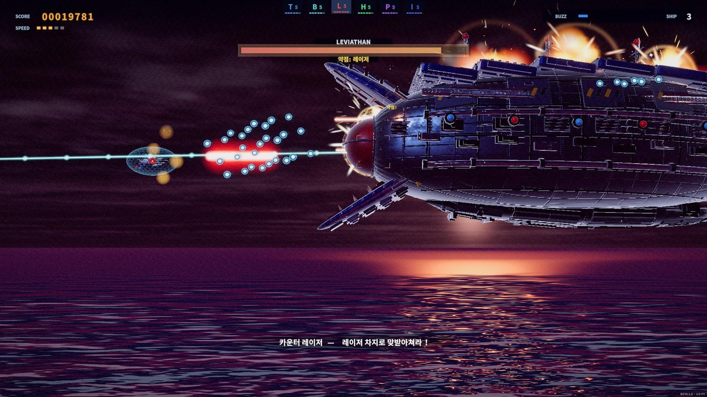
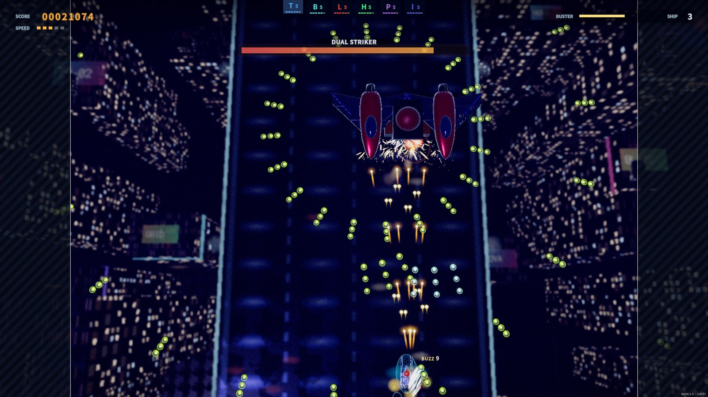
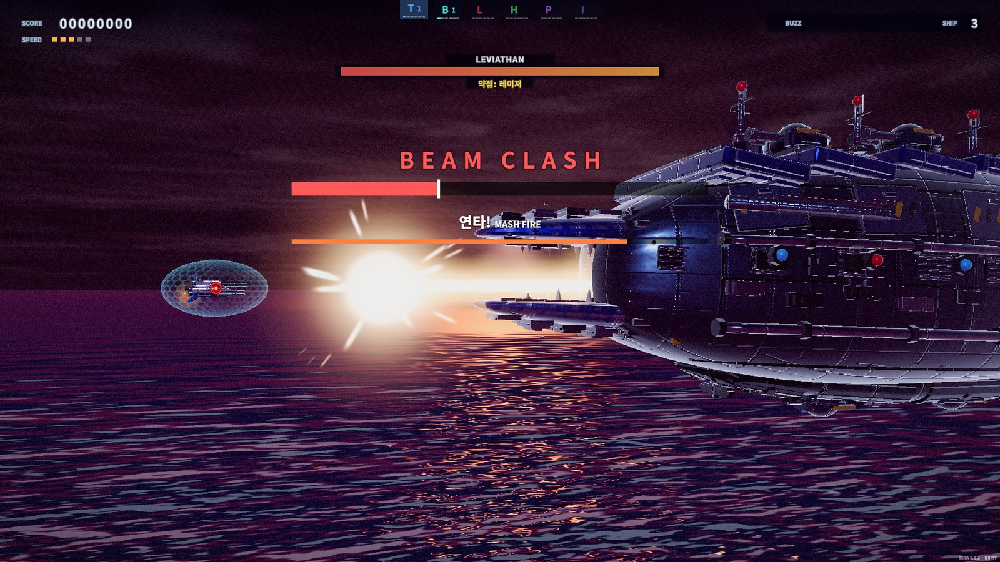
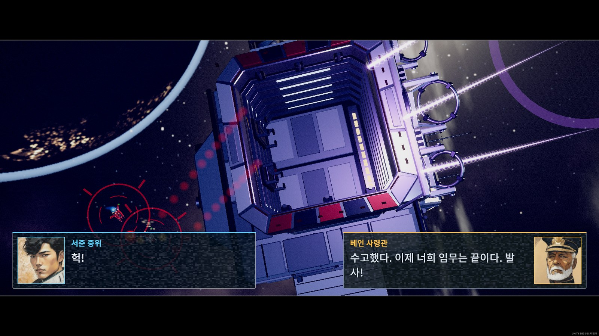
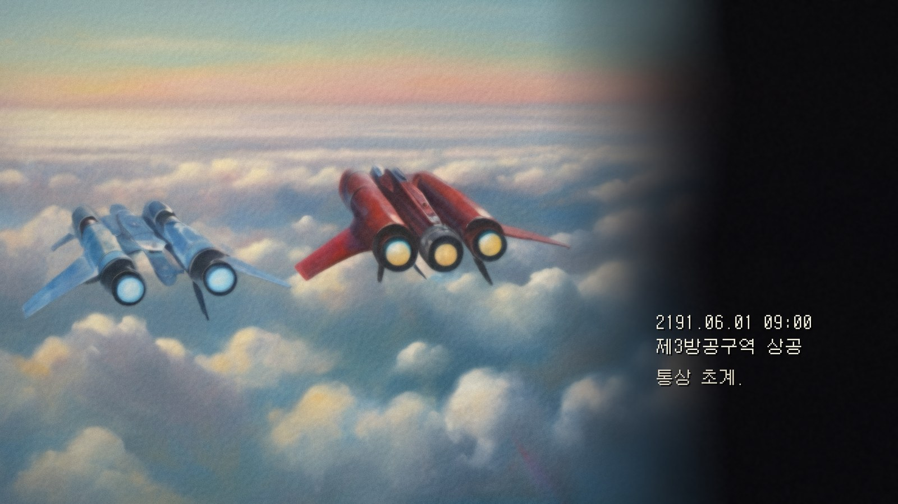
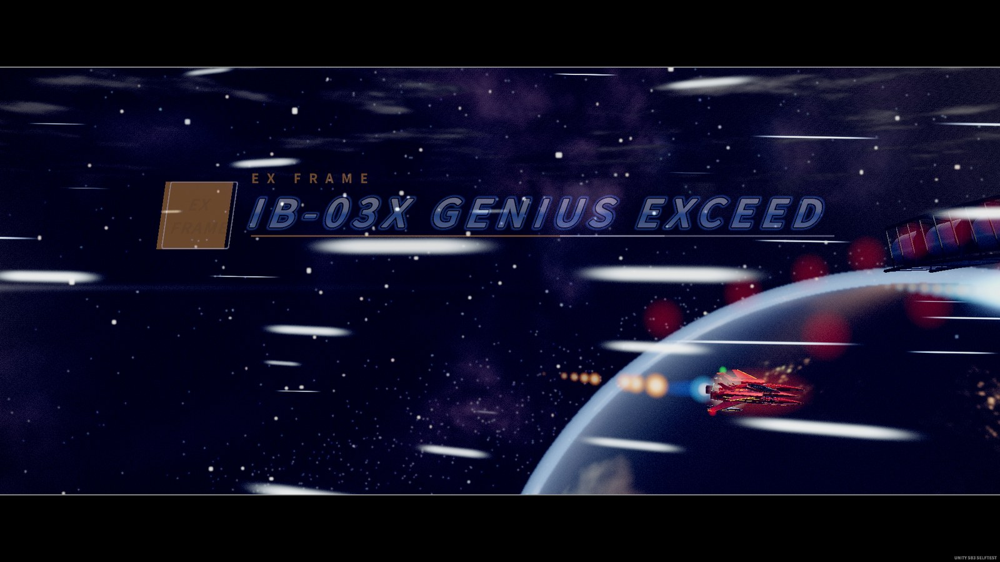
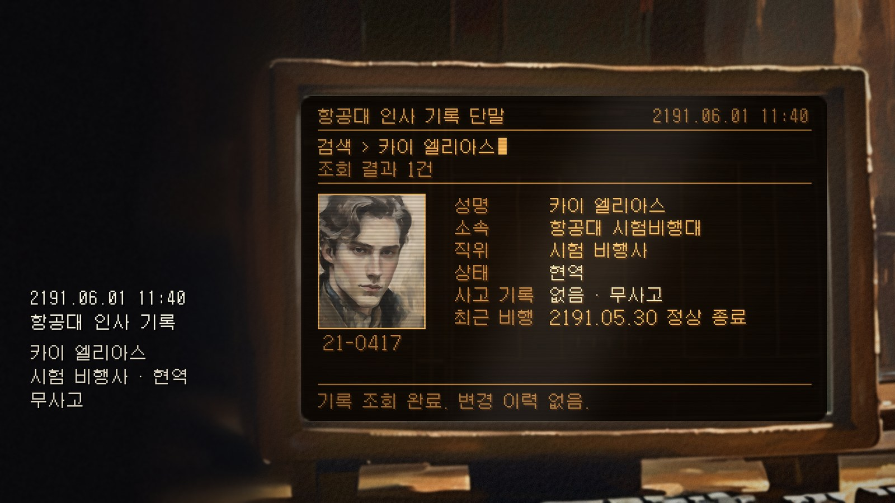
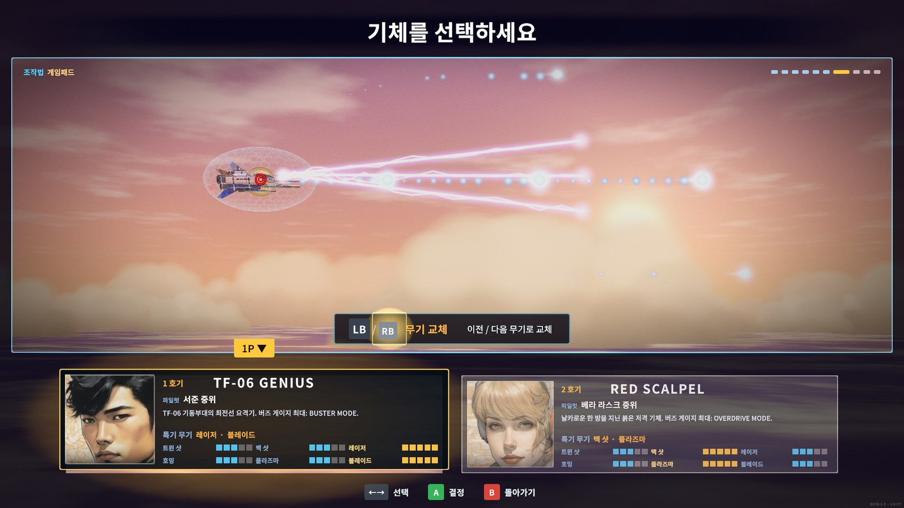

<h1 align="center">일루전 포스 · ILLUSION FORCE</h1>

<b>베타 1.0.3</b> · 윈도우 · 안드로이드 · 15개 언어 · 한국어 음성

<b>가로와 세로 스크롤을 오가는 오리지널 슈팅 게임</b> 
두 시험 비행사, 되풀이되는 세계, 그리고 깨어나지 않는 하늘의 이야기.

<a href="../../releases"><b>▶ 내려받기 (릴리스 페이지)</b></a>

> © 2026 KIM JUHYUN. All rights reserved.

<table>
<tr>
<td></td>
<td></td>
</tr>
<tr>
<td></td>
<td></td>
</tr>
</table>

## 내려받기

[릴리스](../../releases) 페이지에서 받을 수 있습니다.

| 파일 | 기기 |
|---|---|
| `IllusionForce_Beta1.0.3_Unity_Win64.zip` | 윈도우 64비트 (유니티판, 기본) |
| `IllusionForce_Beta1.0.3_Godot_Win64.zip` | 윈도우 64비트 (고닷판) |
| `IllusionForce_Beta1.0.3_Android.apk` | 안드로이드 |

- **윈도우:** 압축을 풀고 `IllusionForce.exe`를 실행합니다.
- **안드로이드:** 설치 파일(APK)을 설치합니다. 예전 시험판이 있으면 먼저 지운 뒤 설치하세요.

## 이야기

2191년. 시험 비행사 서준과 베라는 실험기 **TF-06 GENIUS**와 **RED SCALPEL**을 몰고, 정체불명의 코어가 붕괴한 뒤 나타난 기계 생명체와 싸웁니다.

임무가 끝나자 사령부의 포구가 두 사람을 향하고, 존재할 리 없는 기체 **0호기**가 잔해 속에서 그들을 구해 냅니다.

전쟁은 지구연방과 외계 군체, 두 갈래로 나뉩니다. 마지막 성역에 닿기 전까지 모든 길의 끝은 행성의 멸망이고, 그때마다 시간이 되감깁니다.

## 게임의 특징

### 갈라지는 전장, 되풀이되는 세계
- 구름바다, 네온 도시, 심해 해구, 궤도 링, 허수 차원 등 가로·세로 스크롤을 오가는 **17개 구역**이 있습니다.
- 루트가 갈라지고, **배드 엔딩 다섯 개**와 **진 엔딩** 하나가 있습니다. 멸망한 세계는 다음 회차로 되감기고, 파일럿은 그 기억을 간직합니다.
- 2회차부터는 강화된 **EX 기체**로 시작하고, 진 엔딩을 보면 숨겨진 모드가 열립니다.

### 약점 무기 보스전
- 무기는 **트윈 샷, 백 샷, 레이저, 호밍, 플라즈마, 블레이드** 여섯 가지이고, 무기마다 모아 쏘기가 있습니다.
- 보스는 형태마다 **약점 무기**가 다릅니다. 보스가 나타나면 오퍼레이터가 **스캔**으로 약점 부위를 표시하고 약점 무기를 알려 줍니다. 보스가 변형하면 다시 스캔합니다.
- 거대한 적 빔을 모아 쏜 빔으로 맞받아치는 **빔 크래시**가 있습니다.
- 탄과 빔을 아슬아슬하게 스치는 **버즈**로 게이지를 채우면 BUSTER / OVERDRIVE 모드가 발동합니다.
- **스펙트럴 분신**은 잔상을 남겨 두었다가 그 자리와 위치를 바꿉니다.

### 난이도와 점수
- 난이도는 **아주 쉬움 · 쉬움 · 보통 · 어려움 · 극한** 다섯 단계입니다. 아주 쉬움은 슈팅 게임이 처음인 분도 이야기를 끝까지 볼 수 있게 탄과 보스를 크게 약하게 했습니다.
- 난이도가 높을수록 점수 배율이 올라갑니다(×0.5 ~ ×1.7). 노미스·약점 무기 처치·클리어 보너스가 있고, 점수판에 난이도가 함께 표시됩니다.
- 2회차부터는 회차마다 적 배치와 보스 패턴 순서가 달라집니다.

### 연출
- 3D로 그린 기체와 보스, 그리고 오프닝·존 X·엔딩 연출이 있습니다.
- 진 엔딩 후일담은 **손으로 그린 듯한 유화풍 정지 그림**으로 펼쳐집니다.
- 한국어를 고르면 등장인물과 오퍼레이터의 **한국어 음성**이 나옵니다(다른 언어는 영어 오퍼레이터 음성).
- 자막과 메뉴는 **15개 언어**를 지원합니다.
- 음악은 모두 오리지널입니다.

### 조작
- 키보드, 게임패드, 터치(안드로이드)를 지원하고, 쓰는 기기에 맞춰 버튼 표시가 바로 바뀝니다.
- 기체 선택 화면에서 고른 기체가 모든 조작을 직접 **시연**합니다.
- 약점 부위 표시, 등장인물·오퍼레이터 음성 켜기·끄기, 터치 감도(안드로이드) 등 옵션이 있습니다.

## 의견·버그 제보

베타 버전입니다. [이슈](../../issues)에 버그와 감상을 남겨 주세요.

---

<b>English</b>

### ILLUSION FORCE — BETA 1.0.3

An original shoot 'em up that switches between horizontal and vertical scrolling. Two test pilots, a world caught in a loop, and a sky that refuses to wake up.

**Download:** get the Windows (Unity / Godot) zip or the Android APK from the [Releases](../../releases) page. On Windows, unzip and run `IllusionForce.exe`. On Android, uninstall any older test build first.

**Story:** in 2191, test pilots Seo Jun and Vera fly the experimental fighters TF-06 GENIUS and RED SCALPEL against mechanical life forms. When the mission ends, their own command turns its guns on them, and a ship that should not exist, Unit 0, pulls them out of the wreckage. The war splits in two, and every road short of the final sanctuary ends with the planet destroyed and time rewound.

**Features**
- 17 zones alternating horizontal and vertical scrolling, with branching routes, five bad endings and a true ending. The world rewinds into the next loop, and your pilots remember.
- Five difficulties from VERY EASY to EXTREME, with score multipliers (×0.5 – ×1.7) and bonuses; enemy layouts change every loop from loop 2.
- Six weapons with charge attacks. Every boss phase has a weak weapon, revealed by the operator's SCAN; beam clash; buzz-powered BUSTER / OVERDRIVE; Spectral Split.
- 3D ships and bosses, cinematic sequences and an oil-painted true-ending epilogue.
- Korean voice acting, English operator voice, subtitles and menus in 15 languages, original soundtrack.
- Keyboard, gamepad and touch, with a live controls demo on the ship-select screen.

**Feedback:** please open an [Issue](../../issues).

